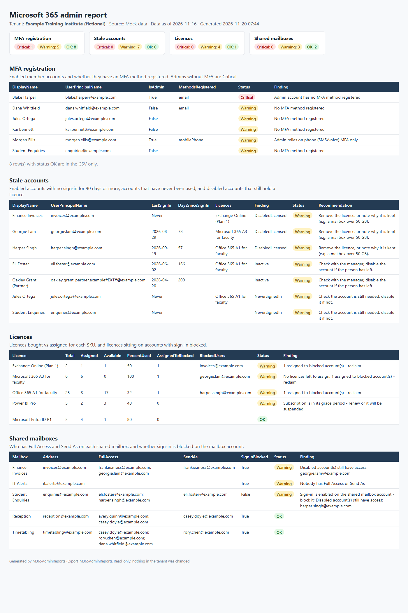

# Microsoft 365 Admin Reports (PowerShell)

[](https://github.com/ManojFam/m365-admin-reports/actions/workflows/ci.yml)

A PowerShell module of read-only **Microsoft 365 / Entra ID** reports that a service desk or
sysadmin runs every week. It uses the **Microsoft Graph PowerShell SDK** (and the Exchange
Online module for shared mailboxes).

| Question the report answers | Command |
|---|---|
| **MFA:** who has no MFA method registered, and are any of them admins? | `Get-M365MfaStatusReport` |
| **Stale accounts:** which enabled accounts have not signed in for 90 days, and which disabled accounts still hold a licence? | `Get-M365StaleAccountReport` |
| **Licences:** how many of each licence have we bought, assigned and got left, and which are sitting on blocked accounts? | `Get-M365LicenceReport` |
| **Shared mailboxes:** who has Full Access and Send As, and is anything risky? | `Get-M365SharedMailboxAudit` |
| **All of the above** as one HTML page plus a CSV per report | `Export-M365AdminReport` |

Every command has a **mock mode** (`-Mock`). It reads a made-up sample tenant from JSON files
instead of calling Microsoft 365, so you can try everything on any Windows PC without a
tenant, an admin account or an internet connection.

Runs on Windows PowerShell 5.1 and PowerShell 7. It is tested on both in GitHub Actions.

## Quick start (mock mode, no tenant needed)

```powershell
git clone https://github.com/ManojFam/m365-admin-reports.git
cd m365-admin-reports
Import-Module .\M365AdminReports\M365AdminReports.psd1

# One report at a time
Get-M365MfaStatusReport -Mock | Format-Table DisplayName, IsAdmin, MfaRegistered, Status, Finding
Get-M365StaleAccountReport -Mock | Format-Table DisplayName, LastSignIn, DaysSinceSignIn, Finding
Get-M365LicenceReport -Mock | Format-Table Licence, Total, Assigned, Available, AssignedToBlocked, Status
Get-M365SharedMailboxAudit -Mock | Format-Table Mailbox, FullAccess, SendAs, Status

# Everything: one HTML page and four CSVs
Export-M365AdminReport -Mock -OutputPath .\output
Invoke-Item .\output\m365-admin-report.html
```

Every command has help: `Get-Help Get-M365StaleAccountReport -Full`.

The sample tenant is in [M365AdminReports/mock](M365AdminReports/mock). It is fictional:
"Example Training Institute", 22 accounts on `example.com`, made-up names and IDs. You can copy
the folder, edit the JSON and point the commands at it with `-MockPath .\my-mock-folder`.

## Sample output



The full page is in [samples/m365-admin-report.html](samples/m365-admin-report.html). It is a
single file with the CSS inline and no scripts, so you can email it or attach it to a ticket.
The CSVs next to it ([samples/](samples)) have every row, ready for Excel.

```text
PS> Get-M365MfaStatusReport -Mock | Where-Object Status -ne 'OK' | Format-Table DisplayName, IsAdmin, MethodsRegistered, Status, Finding

DisplayName       IsAdmin MethodsRegistered Status   Finding
-----------       ------- ----------------- ------   -------
Blake Harper         True email             Critical Admin account has no MFA method registered
Dana Whitfield      False email             Warning  No MFA method registered
Jules Ortega        False                   Warning  No MFA method registered
Kai Bennett         False                   Warning  No MFA method registered
Morgan Ellis         True mobilePhone       Warning  Admin relies on phone (SMS/voice) MFA only
Student Enquiries   False                   Warning  No MFA method registered

PS> Get-M365LicenceReport -Mock | Format-Table Licence, Total, Assigned, Available, BlockedUsers, Status

Licence                      Total Assigned Available BlockedUsers             Status
-------                      ----- -------- --------- ------------             ------
Exchange Online (Plan 1)         2        1         1 invoices@example.com     Warning
Microsoft 365 A3 for faculty     6        6         0 georgie.lam@example.com  Warning
Office 365 A1 for faculty       25        8        17 harper.singh@example.com Warning
Power BI Pro                     5        2         3                          Warning
Microsoft Entra ID P1            5        4         1                          OK
```

## Using it with a real tenant

### 1. Install the modules

```powershell
Install-Module Microsoft.Graph.Authentication, Microsoft.Graph.Users, Microsoft.Graph.Reports, Microsoft.Graph.Identity.DirectoryManagement -Scope CurrentUser
Install-Module ExchangeOnlineManagement -Scope CurrentUser   # only for the shared mailbox audit
```

### 2. Connect with read-only permissions

```powershell
Connect-MgGraph -Scopes 'User.Read.All', 'AuditLog.Read.All', 'Reports.Read.All', 'Organization.Read.All'
Connect-ExchangeOnline -ShowBanner:$false
```

### 3. Run the reports (same commands, without `-Mock`)

```powershell
Export-M365AdminReport -OutputPath ".\output\$(Get-Date -Format yyyy-MM-dd)"
```

If Exchange Online is not connected, `Export-M365AdminReport` skips the shared mailbox audit
with a warning and still produces the other three reports.

Live reports contain real names and email addresses. Keep them internal. `output/` is in
`.gitignore` so they do not end up in a repository.

### Permissions (least privilege)

Everything is **read-only**. No command changes anything in the tenant.

| Graph scope | Why it is needed | Used by |
|---|---|---|
| `User.Read.All` | read users, their licences and whether sign-in is blocked | all reports |
| `AuditLog.Read.All` | read `signInActivity` (last sign-in dates) | stale accounts, MFA |
| `Reports.Read.All` | read the authentication methods "user registration details" report | MFA |
| `Organization.Read.All` | read subscribed licences (SKUs) and the tenant name | licences, stale accounts, export |

Things to know:

- With a delegated sign-in (an admin running `Connect-MgGraph`), the person also needs a
  directory role that can read this data. **Global Reader** covers all four reports and cannot
  change anything. **Reports Reader** is enough for the MFA report alone.
- Sign-in dates (`signInActivity`) and the MFA registration report need an
  **Entra ID P1 or P2** licence in the tenant.
- The shared mailbox audit uses `Get-EXOMailbox`, `Get-EXOMailboxPermission` and
  `Get-EXORecipientPermission`. A read-only Exchange role such as **View-Only Recipients**
  (or Global Reader) is enough.
- If your Graph sign-in is missing one of the scopes, the commands print a warning saying
  which one, instead of failing later with a confusing error.
- For a scheduled weekly run, use an app registration with the same four permissions as
  **application** permissions and certificate sign-in (`Connect-MgGraph -ClientId ... -TenantId ... -CertificateThumbprint ...`).
  That has not been tested in this project.

## How it works

```text
M365AdminReports/
  M365AdminReports.psd1   module manifest (version, exported commands)
  M365AdminReports.psm1   loads every file in Private/ and Public/
  Public/                 one file per command people run
  Private/
    Connection.ps1        mock or live? Checks Connect-MgGraph / Connect-ExchangeOnline
    Data.ps1              reads users, MFA, licences, mailboxes (mock JSON or live cmdlets)
    Status.ps1            OK / Warning / Critical rules, licence friendly names
    Html.ps1              builds the self-contained HTML page
  mock/                   the fictional sample tenant (JSON)
tests/                    Pester 5 tests
samples/                  the report generated from the mock tenant
```

### The data layer: one code path for mock and live

Each function in `Private/Data.ps1` has two branches. In **mock mode** it reads a JSON file
(for example `mock/users.json`). In **live mode** it calls the real cmdlet
(`Get-MgUser`, `Get-MgSubscribedSku`, `Get-MgReportAuthenticationMethodUserRegistrationDetail`,
`Get-EXOMailbox`...). The JSON files have the same shape as the Graph responses, and both
branches turn the data into the same simple objects. The report commands only see those
objects, so the rules are written once and the mock data runs exactly the same logic as a
real tenant.

Small details this handles:

- Graph returns dates as `DateTime` objects; JSON gives text. PowerShell 7 converts JSON dates
  by itself and 5.1 does not. Everything is converted to UTC before comparing.
- Graph objects use `PascalCase` names (`AccountEnabled`) and the JSON uses `camelCase`
  (`accountEnabled`). PowerShell property names are not case-sensitive, so the same code reads both.

### What each report checks

**MFA status.** Joins each user with their row in the Entra ID registration report.

- Critical: an admin with no MFA method registered (the highest-risk account in the tenant).
- Warning: a user with no MFA method, or an admin whose only method is a phone (SMS/voice),
  which is the easiest to phish or SIM-swap. Email counts for password reset only, not MFA.
- Disabled accounts (cannot sign in) and guests (they register MFA in their own tenant) are
  left out unless you add `-IncludeDisabled` / `-IncludeGuests`.

**Stale accounts.** Finds three kinds of account:

- `Inactive`: enabled, last sign-in at least `-InactiveDays` (default 90) days ago. "Last
  sign-in" is the later of the interactive and non-interactive dates, so someone whose phone
  keeps Outlook connected is not flagged.
- `NeverSignedIn`: enabled, never used, and created more than `-InactiveDays` ago. New starters
  who have not signed in yet are not flagged.
- `DisabledLicensed`: disabled but still holding a licence, which is money being wasted.

Mock data is a snapshot, so in mock mode ages are measured from the snapshot date in
`mock/tenant.json` (16 November 2026) and the results do not change as time passes. Live mode
measures from today. `-ReferenceDate` overrides both.

**Licences.** For each SKU: Total = prepaid units enabled, Assigned = consumed units,
Available = Total - Assigned. It also lists which blocked accounts hold that licence so they can
be reclaimed.

- Critical: more assigned than bought, or the subscription is suspended / locked out.
- Warning: none left, subscription in its grace period, or licences on blocked accounts.

**Shared mailboxes.** For each shared mailbox, lists who has Full Access and Send As
(system entries such as `NT AUTHORITY\SELF` and inherited admin rights are skipped), then warns when:

- sign-in is enabled on the mailbox's own account (it should be blocked, so nobody can sign in
  to it directly with a password),
- a disabled account (usually a leaver) still has access,
- nobody has access at all.

### The HTML report

`Export-M365AdminReport` runs the four reports, saves each one to CSV with every row, and
builds one HTML page. The page has a summary card per report (how many Critical / Warning /
OK) and a table for each. The MFA table only shows accounts that need attention, so it stays
short in a big tenant; the CSV has everyone. Every value is HTML-encoded, so a display name
containing `<` or `&` cannot break the page.

## Tests

```powershell
Install-Module Pester -RequiredVersion 5.7.1 -Scope CurrentUser -SkipPublisherCheck
Install-Module PSScriptAnalyzer -Scope CurrentUser
.\Invoke-Tests.ps1
```

There are 50 Pester tests, covering every command against the mock tenant: each MFA, stale
account, licence and shared mailbox rule, the `-InactiveDays`, `-ReferenceDate`,
`-IncludeGuests`, `-MockPath` and `-SkipSharedMailbox` options, the CSV and HTML files, and
HTML encoding.

The live branches are tested too, without a tenant. The Graph and Exchange modules are not
installed on the CI runners, so [tests/GraphStubs.ps1](tests/GraphStubs.ps1) creates empty
stand-in functions and Pester mocks them with Graph-shaped objects. Those tests check that the
right cmdlets are called, that a missing connection or scope gives a clear message, and that
system entries are filtered out of mailbox permissions.

The live mode has **not** been run against a real tenant. Try it in a test or dev tenant first
(the free Microsoft 365 Developer Program tenant works if you qualify).

GitHub Actions runs PSScriptAnalyzer and the tests on Windows PowerShell 5.1 and
PowerShell 7 for every push.

## Interview talking points

- **Least privilege.** The module only needs four read-only Graph scopes, and I can explain why
  each one is needed and which directory role (Global Reader) a person needs on top.
- **Why admins without MFA are Critical.** Admin accounts are the main target of phishing and
  password spraying. Microsoft's own guidance is that MFA blocks the large majority of account
  compromise attacks. Phone-only MFA on admins is flagged too, because SMS can be phished or
  SIM-swapped; Authenticator or a passkey is stronger.
- **Stale accounts are a security and cost issue.** An unused enabled account is a way in that
  nobody is watching. A disabled account with a licence is money wasted. The report uses
  both interactive and non-interactive sign-ins to avoid false positives, and does not flag
  new starters.
- **Offboarding gaps show up in the data.** A leaver who still has Full Access to a shared
  mailbox, or a disabled account still holding an A3 licence, are signs the offboarding
  checklist missed a step. This report catches them each week.
- **Shared mailbox hygiene.** Shared mailbox accounts should have sign-in blocked, because
  access should come through delegated permissions, not a shared password.
- **Mock mode and testability.** The data layer is split from the rules, so the same logic
  runs against JSON fixtures or a live tenant. That made it possible to test every rule in CI
  without a tenant and to demo it safely without showing real staff data.
- **Graph vs the old MSOnline / AzureAD modules.** Those modules are retired; Microsoft Graph
  PowerShell is the supported way to automate Entra ID and Microsoft 365.

## License

[MIT](LICENSE)
